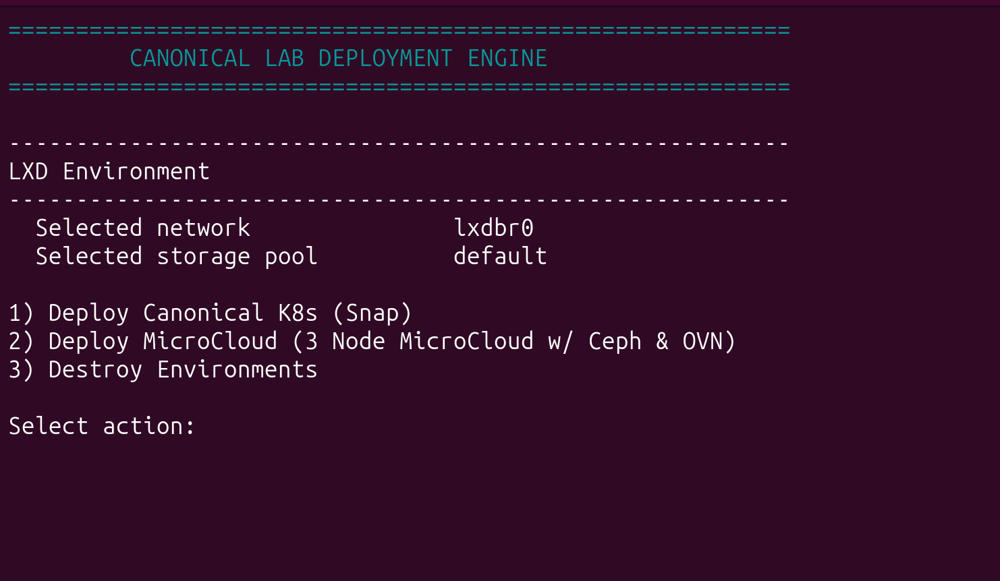
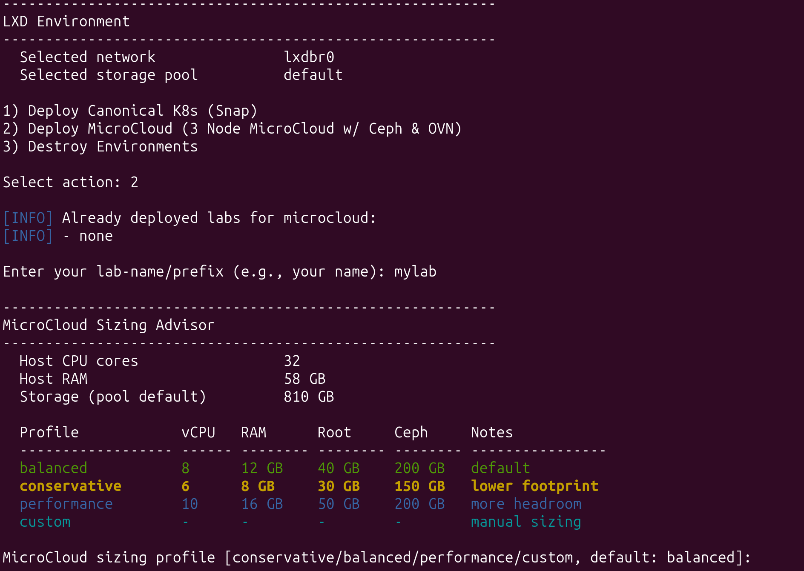
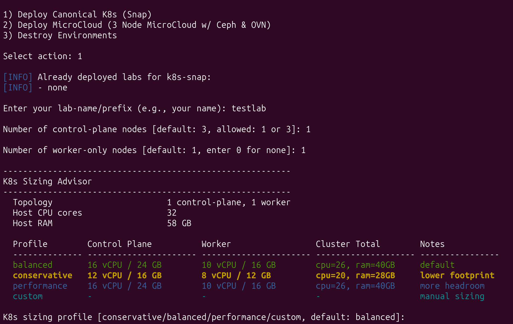
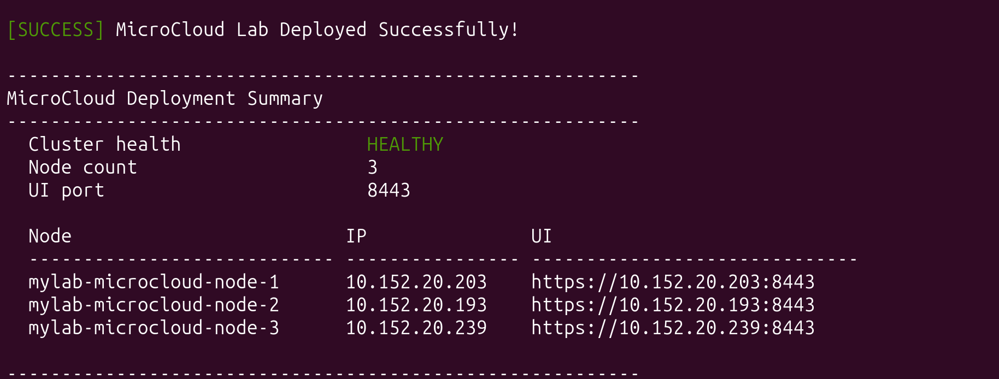
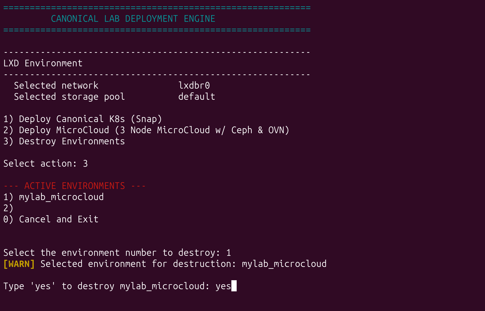

# Canonical Lab Automation

Canonical Lab Automation is a guided command-line tool for creating repeatable
Canonical infrastructure labs on a single LXD host. It provisions Ubuntu
virtual machines with OpenTofu and, for full deployments, configures the
selected product with Ansible.

The project supports:

- **MicroCloud**
- **Canonical Kubernetes (Snap)**
- **Canonical Kubernetes (Juju)**

Each product is available as either a complete, automated deployment or an
infrastructure-only training environment.

> [!IMPORTANT]
> This project is intended for labs, demonstrations, learning, and functional
> testing. It is not a production deployment or high-availability solution.
> All virtual machines run on the same LXD host.

## Contents

- [Choose a Lab Type](#choose-a-lab-type)
- [How the Automation Works](#how-the-automation-works)
- [Product Versions](#product-versions)
- [Requirements](#requirements)
- [Install and Prepare the Host](#install-and-prepare-the-host)
- [Quick Start](#quick-start)
- [Full and Training Deployments](#full-and-training-deployments)
- [Lab Names and Isolation](#lab-names-and-isolation)
- [Deploy Multiple Identical Labs](#deploy-multiple-identical-labs)
- [Sizing Profiles](#sizing-profiles)
- [Deploy MicroCloud](#deploy-microcloud)
- [Deploy Canonical Kubernetes (Snap)](#deploy-canonical-kubernetes-snap)
- [Deploy Canonical Kubernetes (Juju)](#deploy-canonical-kubernetes-juju)
- [Instructor Cluster Manager Service](#instructor-cluster-manager-service)
- [Instructor Landscape Demo](#instructor-landscape-demo)
- [Instructor COS Lite Demo](#instructor-cos-lite-demo)
- [Instructor MAAS Demo](#instructor-maas-demo)
- [Lab Overview](#lab-overview)
- [Manage Existing Labs](#manage-existing-labs)
- [Access a Lab](#access-a-lab)
- [Safety and Operational Behavior](#safety-and-operational-behavior)
- [Troubleshooting](#troubleshooting)
- [Further Reading and Support](#further-reading-and-support)
- [Project Layout](#project-layout)

## Choose a Lab Type

Use this table if you are not sure which option to select.

| Lab | Use it when you want to | Default topology |
| --- | --- | --- |
| MicroCloud | Learn or test clustered LXD, MicroCeph, and MicroOVN | 3 nodes |
| Canonical Kubernetes (Snap) | Run Canonical Kubernetes directly from the `k8s` snap | 3 control-plane nodes and 1 worker |
| Canonical Kubernetes (Juju) | Deploy Canonical Kubernetes as Juju-managed applications | 1 Juju controller, 1 Kubernetes control-plane node, and 1 worker |
| Training variant | Receive prepared virtual machines, networking, disks, and SSH access without automated product installation | Matches the selected product |

For a first test, the recommended starting point is a **training lab**. It
validates the infrastructure and SSH access without installing or bootstrapping
the product.

## How the Automation Works

The deployment has three layers:

1. **LXD** runs the virtual machines and provides storage and networking.
2. **OpenTofu** creates and tracks the infrastructure.
3. **Ansible** installs and configures the selected product for full deployments.

The main scripts are:

- `prep_host.sh`: prepares the host and validates prerequisites.
- `orchestrate.sh`: creates, updates, rebuilds, or destroys labs.

Some terms used in this guide:

- **Host**: the physical or virtual Linux machine running LXD.
- **Node**: an LXD virtual machine that belongs to a lab.
- **NIC**: a network interface attached to a virtual machine.
- **CIDR**: an IP subnet written in a form such as `172.28.40.0/24`.
- **Control plane**: Kubernetes nodes that manage the cluster.
- **Worker**: a Kubernetes node intended to run workloads.

## Product Versions

Full deployments install the following snap channels and charms. Training
deployments install nothing; participants install the products themselves.

| Product | Channel |
| --- | --- |
| MicroCloud (LTS) | `microcloud` snap `3/stable` |
| LXD | `lxd` snap `6/stable` |
| MicroCeph | `microceph` snap `tentacle/stable` |
| MicroOVN | `microovn` snap `26.03/stable` |
| Canonical Kubernetes (Snap) | `k8s` snap `1.35-classic/stable` |
| Juju (LTS) | `juju` snap `3.6/stable` |
| Canonical Kubernetes (Juju) | `k8s` and `k8s-worker` charms `1.35/stable`, base `ubuntu@24.04` |

The MicroCloud snaps are installed with `--cohort=+` in the order given in the
MicroCloud documentation. On reruns, snaps that are already installed are not
switched to another channel; the playbook warns instead, because moving a
running cluster to another track is an upgrade.

## Requirements

### Host requirements

You need:

- a Linux host capable of running LXD virtual machines;
- hardware virtualization support (`/dev/kvm`);
- a regular user account with `sudo` access;
- internet access for Ubuntu images, snaps, packages, Ansible content, and
  product artifacts;
- enough CPU, memory, and storage for the selected topology.

The automated preparation path uses `apt` and `snap`, so an Ubuntu host is
recommended.

There is no single hardware minimum for every scenario. Before provisioning,
the sizing advisor examines the host and proposes values for the selected
topology. MicroCloud requires at least three nodes and therefore needs more
resources than a small single-node Kubernetes lab.

> [!NOTE]
> Single-lab sizing evaluates the selected lab against the host's total
> resources. Review existing allocations before accepting a large single-lab
> profile. Batch sizing accounts for existing LXD commitments and divides the
> remaining CPU and RAM budget across all requested labs.

### Software

The project uses:

- LXD
- OpenTofu
- Ansible
- the `community.general` Ansible collection
- OpenSSH client tools

The preparation script installs or configures missing requirements.

## Install and Prepare the Host

### 1. Download the repository

The recommended method is Git:

```bash
git clone https://github.com/ismailkayi/lab-automation.git
cd lab-automation
```

To test changes that have not yet reached the default branch:

```bash
git clone --branch staging \
  https://github.com/ismailkayi/lab-automation.git \
  lab-automation-staging
cd lab-automation-staging
```

The `staging` branch can change more frequently. Use the default branch unless
you specifically need a feature that is still under validation.

If Git is not available, download the default branch as a ZIP archive:

```bash
wget \
  https://codeload.github.com/ismailkayi/lab-automation/zip/refs/heads/main \
  -O lab-automation.zip
unzip lab-automation.zip
cd lab-automation-main
```

### 2. Prepare the host

Run the preparation script as the regular user who will operate the labs:

```bash
chmod +x prep_host.sh
./prep_host.sh
```

The script can:

- install LXD, OpenTofu, Ansible, and OpenSSH client tools;
- initialize LXD when no storage pool exists;
- create a usable LXD bridge when needed;
- add the current user to the `lxd` group;
- install the required Ansible collection;
- create the lab SSH key at `~/.ssh/id_rsa_lab`;
- initialize the OpenTofu providers;
- validate LXD storage, networking, and non-root access;
- repair ownership left by an earlier run with `sudo`.

If the script adds you to the `lxd` group, activate the new membership before
continuing:

```bash
newgrp lxd
```

Alternatively, sign out and sign in again.

> [!WARNING]
> Do not run `orchestrate.sh` with `sudo`. The orchestrator deliberately stops
> when run as root so that SSH keys, OpenTofu state, and inventory files remain
> owned by the regular lab user.

### 3. Verify host access

These commands should complete without `sudo`:

```bash
lxc info
tofu version
ansible --version
```

## Quick Start

From the repository directory:

```bash
chmod +x orchestrate.sh
./orchestrate.sh
```

The main menu is grouped by purpose:

```text
FULL LAB DEPLOYMENTS
  1) MicroCloud (automated deployment)
  2) Canonical K8s - Snap (automated deployment)
  3) Canonical K8s - Juju (automated deployment)

TRAINING LABS - INFRASTRUCTURE ONLY
  4) MicroCloud Training
  5) Canonical K8s - Snap Training
  6) Canonical K8s - Juju Training

ENVIRONMENT MANAGEMENT
  7) Lab overview (nodes, uplink values, logins)
  8) Destroy Environments

INSTRUCTOR SERVICES
  9) Cluster Manager (central view of MicroClouds; participant accounts)
 10) Landscape 26.04 (server + Ubuntu 26.04/24.04/22.04 clients)
 11) COS Lite (Grafana, Prometheus, Loki; monitors this host's LXD)
 12) MAAS 3.8 (commission, deploy and release demo machines)

  0) Exit
```

Options 1-6 create the participant labs. The instructor services (9-12) run in
separate VMs on the lab host, are installed by the instructor and are removed
with **8) Destroy Environments**; **7) Lab overview** lists them in a separate
section from the participant labs.

Type a number and press Enter. When an action finishes, or is cancelled, its
output stays on screen until you press Enter; the menu then appears again, so
one session can run several actions in a row. Choose `0` or press Ctrl-D to
exit. An invalid entry asks again, and a failed action shows its exit status
before the prompt. Ctrl-C ends the script immediately. When the input is piped
instead of typed, there is no pause and the menu follows at once.

For a first deployment:

1. Choose a full or training scenario.
2. Choose **Deploy a new lab**.
3. Choose a single lab or a sequential batch.
4. Enter a short lab name, for example `demo`.
5. Select the topology and sizing profile.
6. Review the displayed configuration.
7. Wait for infrastructure provisioning and validation to finish.
8. Use the final summary to connect to the lab.

Screenshots may differ slightly as menu options evolve.



## Full and Training Deployments

| Behavior | Full deployment | Training deployment |
| --- | --- | --- |
| Creates LXD virtual machines | Yes | Yes |
| Creates networking and disks | Yes | Yes |
| Injects the lab SSH key | Yes | Yes |
| Waits for cloud-init | Yes | Yes |
| Validates node access | Yes, through the Ansible/LXD connection | Yes, through SSH to every node |
| Installs product packages | Yes | No |
| Bootstraps the product or cluster | Yes | No |

Training labs intentionally leave product installation to the participant:

- **MicroCloud Training** leaves MicroCloud, MicroCeph, MicroOVN, and LXD
  installation and cluster initialization to the participant. Each node also
  receives an extra local disk for storage exercises.
- **Canonical Kubernetes Snap Training** leaves `k8s` snap installation and
  cluster bootstrap to the participant.
- **Canonical Kubernetes Juju Training** leaves Juju installation, controller
  bootstrap, and application deployment to the participant.

Full and training labs use separate OpenTofu workspaces. The same short name
can therefore be used once for a full lab and once for a training lab.

## Lab Names and Isolation

When prompted, enter a short name containing letters and numbers:

```text
demo
```

The orchestrator converts it into a scenario-specific OpenTofu workspace:

| Selection | Workspace |
| --- | --- |
| MicroCloud | `demo_microcloud` |
| MicroCloud Training | `demo_training-microcloud` |
| Kubernetes Snap | `demo_k8s-snap` |
| Kubernetes Snap Training | `demo_training-k8s-snap` |
| Kubernetes Juju | `demo_k8s-juju` |
| Kubernetes Juju Training | `demo_training-k8s-juju` |

Workspaces keep the OpenTofu state for each lab separate. LXD resource names
use the same prefix with LXD-safe hyphens.

Do not manually delete the `terraform.tfstate.d/` directory. It contains the
state required to update and safely destroy existing labs.

## Deploy Multiple Identical Labs

Batch deployment creates 2 to 50 labs with one shared configuration. It is
useful for classrooms, workshops, and repeatable multi-user test environments.

After choosing **Deploy a new lab**, select:

```text
Deployment Scope
  1) Single lab (default)
  2) Multiple identical labs (sequential batch)
```

The orchestrator then asks for:

- the number of labs;
- a base lab name;
- the topology, network mode, and sizing profile used by every lab.

CPU sharing is managed automatically. There is no overcommit-ratio prompt.
The internal ceiling is **4 vCPUs per host CPU thread (4:1)**, intended for
shared, non-performance lab use rather than dedicated CPU performance.

For a base name of `student` and 12 labs, names are generated with zero-padded
numbers:

```text
student01
student02
...
student12
```

Each lab receives its own:

- OpenTofu workspace;
- Ansible inventory;
- LXD resource names;
- MicroCloud uplink network and uplink subnet (see [OVN uplink and external access](#ovn-uplink-and-external-access));
- OVN underlay and Ceph CIDRs in four-NIC mode.

### Batch capacity admission

Before the first lab is created, the orchestrator displays an aggregate plan:

```text
Batch Capacity Plan
  Labs                         12
  New virtual machines         36
  Physical CPU threads         96
  CPU commit ceiling           384 vCPU (4:1 internal limit)
  Requested CPU                288 vCPU
  CPU after deployment         288 vCPU (3.00:1)
  Requested RAM                432 GiB
```

Admission rules:

- existing LXD CPU and RAM limits are counted;
- VMs belonging to the batch being resumed are replaced by the requested
  batch values instead of being counted twice;
- CPU commitment must not exceed the internal 4:1 ceiling;
- RAM is not overcommitted;
- physical RAM must cover committed VM memory plus 15% host overhead, with at
  least 4 GiB left for the host;
- the selected management subnet must have enough estimated addresses;
- logical disk demand is reported, but may exceed current physical free space
  when the LXD storage driver provides thin or sparse volumes.

Sizing recommendations use the **remaining host-wide budget divided across
all requested labs**, rather than treating every lab as if the host were empty.
The Juju controller's 2 vCPUs and 4 GiB RAM per lab are reserved before sizing
Kubernetes nodes. `balanced` targets 75% of each lab's remaining CPU budget,
rounded to practical node sizes; `performance` can use more without exceeding
the ceiling. Four-to-one is a maximum, not a target every batch must reach.

Custom CPU and memory values are kept exactly as entered. If the complete
batch would exceed its CPU or RAM budget, the orchestrator stops with an
explanation instead of silently reducing the values.

If the effective limits of an existing LXD instance cannot be read or
interpreted, batch sizing stops rather than assuming that instance uses no
resources. Configure explicit CPU and memory limits before retrying.

Type `yes` after reviewing the plan to begin.

### Execution and recovery

Labs are created **sequentially**, not in parallel. Sequential deployment
reduces load on the LXD storage pool, image server, Snap Store, and package
repositories.

The batch stops at the first failure and prints a status for every lab:

```text
student01   SUCCESS
student02   SUCCESS
student03   FAILED
student04   NOT STARTED
```

To resume, run the same scenario and enter the same batch count, base name,
topology, network mode, and sizing. Existing compatible workspaces are
reconciled, and missing resources or product configuration are retried.
If other host allocations have changed, automatic profile suggestions can also
change; use `custom` with the original values when resuming existing labs.

For safety, resume is rejected when an existing lab has:

- more nodes than the requested topology;
- different per-node CPU or memory sizing;
- a different MicroCloud network mode.

Use the individual rebuild workflow when one of those creation-time choices
must change.

In four-NIC batch mode, collision-free OVN and Ceph CIDRs are assigned
automatically. Existing owned CIDRs are reused during resume.

## Sizing Profiles

Before a new or rebuilt lab is created, the orchestrator examines host CPU,
memory, and, where applicable, storage. It then presents practical sizing
profiles:

| Profile | Purpose |
| --- | --- |
| `balanced` | Recommended default for most labs |
| `conservative` | Lower resource use |
| `performance` | More resources and headroom |
| `custom` | Manually enter per-node values |

The selected values are shown before provisioning.

For MicroCloud, custom sizing includes:

- vCPU per node;
- memory per node in GiB;
- root disk per node in GiB;
- Ceph disk per node in GiB.

For Kubernetes, control-plane and worker nodes are sized separately.





## Deploy MicroCloud

### MicroCloud lab contents

A MicroCloud lab includes:

- 3 to 10 Ubuntu virtual machines;
- one root disk and one dedicated Ceph data disk per node;
- MicroCloud, MicroCeph, MicroOVN, and LXD in full mode;
- an additional local disk per node in training mode;
- one of the network layouts described below.

The default topology is three nodes.

### Choose a network layout

After selecting the node count, choose a network mode.

#### Standard - 2 NICs

This is the default and backward-compatible layout.

| Interface | Purpose |
| --- | --- |
| Management NIC | SSH, MicroCloud discovery, LXD management, and cluster communication |
| OVN uplink NIC | Dedicated OVN uplink; brought up at boot with no IPv4 or IPv6 address |

The Linux interface names are assigned by the guest operating system and can
look like `enp5s0` and `enp6s0`.

Choose this layout for general learning and functional testing.

#### Fully Segregated - 4 NICs

This layout separates management, OVN, and Ceph traffic.

| Interface | Purpose |
| --- | --- |
| `mgmt0` | SSH, MicroCloud discovery, and LXD management |
| `ovn-uplink` | Dedicated IP-free OVN uplink |
| `ovn-underlay` | OVN Geneve encapsulation traffic |
| `ceph-general` | Ceph public/client and internal/replication traffic |

The orchestrator proposes separate `/24` CIDRs for `ovn-underlay` and
`ceph-general`. Press **Enter** to accept the proposed values or enter your own
IPv4 CIDRs.

Before provisioning, it checks the selected CIDRs against:

- host routes;
- LXD managed subnets;
- CIDRs recorded for other managed labs;
- the other selected network plane;
- the OVN uplink pool (`172.30.0.0/16`).

Provisioning stops if a collision is found. Static addresses are matched to
stable MAC addresses and persist across reboots.

Use this layout when you want to study or validate dedicated OVN and Ceph
network planes.

### OVN uplink and external access

In both layouts, the OVN uplink NIC inside each node stays IP-free, as
MicroCloud requires. On a physical deployment, the uplink network also has a
router that owns the gateway address. In the lab, the host-side LXD bridge for
the uplink plays that router role:

- every lab receives its own `/24` from `172.30.0.0/16`;
- the uplink bridge owns the first address (for example `172.30.44.1/24`) and
  NATs traffic to the host's network;
- OVN uses `.100`–`.200` of the same subnet for its routers;
- `.224/27` is reserved for network forwards and load balancers (UPLINK
  `ipv4.routes`).

As a result, instances on OVN networks can reach the internet (packages,
cloud-init, snaps), and network forward addresses can be reached from the
host.

The subnet is chosen automatically, checked against host routes, LXD networks,
and other labs, and recorded on the uplink bridge so that reruns reuse it.

- **Full deployments** configure MicroCloud with these values automatically,
  including the forward and load balancer range.
- **Training deployments** print them in the final summary, and the batch
  summary lists them per lab. Participants enter them during
  `microcloud init`:

```text
OVN uplink values to enter during 'microcloud init':
  IPv4 gateway (CIDR)          172.30.44.1/24
  First IPv4 address           172.30.44.100
  Last IPv4 address            172.30.44.200
  DNS server                   8.8.8.8

For network forwards and load balancers, after 'microcloud init' run:
  lxc network set UPLINK ipv4.routes=172.30.44.224/27
```

> [!NOTE]
> The host routes between lab uplink subnets, so OVN instances in one lab can
> reach another lab's uplink subnet. Labs created before this change keep their
> IP-free uplink bridge and have no external access from OVN networks; rebuild
> them to get a gateway.

If OVN instances still cannot reach the internet, check that the host firewall
allows forwarding for LXD bridges. Docker sets the `FORWARD` chain policy to
`DROP`; see the LXD documentation on configuring the firewall.

### MicroCloud validation

Before cluster bootstrap, the orchestrator validates:

- expected interfaces and addresses;
- an IP-free OVN uplink;
- the management default route;
- plane-specific routes in four-NIC mode;
- all-to-all OVN underlay and Ceph connectivity in four-NIC mode.

After bootstrap, it checks:

- MicroCloud cluster membership;
- Ceph health;
- OVN encapsulation addresses;
- Ceph public and cluster network settings.

A confirmed mismatch fails validation. If a product version does not support
an introspection command or returns an unknown output format, the deployment is
not incorrectly marked as failed. The summary reports:

```text
Deployment: SUCCESS
Validation: PASSED WITH WARNINGS
```

Review the accompanying warning and perform the suggested manual check.

### Complete a new MicroCloud deployment

1. Run `./orchestrate.sh`.
2. Select **MicroCloud** or **MicroCloud Training**.
3. Select **Deploy a new lab**.
4. Enter a lab name.
5. Choose 3 to 10 nodes.
6. Choose the two-NIC or four-NIC network layout.
7. Select a sizing profile.
8. Wait for provisioning and validation.

For a full deployment, the final summary includes cluster health, node
addresses, and web UI links on port `8443`.



### Change an existing MicroCloud lab

MicroCloud node count and network mode are creation-time choices. To change
either value:

1. select the existing lab;
2. choose **Rebuild**;
3. confirm destruction;
4. choose the new topology during redeployment.

A rebuild permanently deletes the existing lab before creating it again.

## Deploy Canonical Kubernetes (Snap)

### Snap lab contents

The Snap scenario creates:

- 1 or 3 control-plane virtual machines;
- 0 or more worker-only virtual machines;
- the Canonical Kubernetes `k8s` snap on every full-deployment node;
- a bootstrapped Kubernetes cluster.

Defaults:

- 3 control-plane nodes;
- 1 worker node.

### Complete a new Snap deployment

1. Run `./orchestrate.sh`.
2. Select **Canonical K8s - Snap** or its training option.
3. Select **Deploy a new lab**.
4. Enter a lab name.
5. Choose 1 or 3 control-plane nodes.
6. Choose the number of workers; enter `0` if none are required.
7. Select a sizing profile.
8. Wait for provisioning and validation.

For a full deployment, the final summary includes:

- the Kubernetes API endpoint;
- control-plane and worker addresses;
- node status from `kubectl get nodes -o wide`.

### Expand an existing Snap cluster

The Snap scenario supports in-place expansion:

1. select **Manage an existing lab**;
2. choose the lab;
3. choose **Add**;
4. enter target node counts greater than or equal to the current counts.

Shrinking in place is not supported. Choose **Rebuild** to reduce the number of
nodes.

## Deploy Canonical Kubernetes (Juju)

### Juju lab contents

The Juju scenario separates Juju management from the Kubernetes nodes:

- 1 dedicated Juju controller VM;
- 1 or 3 Kubernetes control-plane VMs;
- 1 or more Kubernetes worker VMs;
- a Juju manual cloud and workload model;
- Canonical Kubernetes applications deployed by Juju.

Defaults:

- 1 Juju controller;
- 1 Kubernetes control-plane node;
- 1 worker node.

The current implementation uses a single Juju controller. Because all VMs are
on one LXD host, this scenario should not be treated as production HA.

### Complete a new Juju deployment

1. Run `./orchestrate.sh`.
2. Select **Canonical K8s - Juju** or its training option.
3. Select **Deploy a new lab**.
4. Enter a lab name.
5. Choose 1 or 3 Kubernetes control-plane nodes.
6. Choose one or more worker nodes.
7. Select a sizing profile.
8. Wait for provisioning and validation.

For a full deployment, the final summary includes:

- the Juju controller name and address;
- Kubernetes control-plane and worker addresses;
- a command for retrieving the kubeconfig.

### Expand an existing Juju deployment

The Juju scenario supports in-place expansion:

1. select **Manage an existing lab**;
2. choose the lab;
3. choose **Update in place**;
4. enter target control-plane and worker counts greater than or equal to the
   current counts.

Existing node sizing is preserved, and new machines are reconciled into the
Juju model. Shrinking in place is not supported; use **Rebuild** instead.

## Instructor Cluster Manager Service

Menu option **9) Cluster Manager** installs one shared MicroCloud Cluster
Manager per lab host. Every participant gets a separate account, and all
participants can see and manage every cluster registered on that host.
Participants create their own join token in the UI.

> [!WARNING]
> Keycloak runs over **HTTP** and participant passwords are deliberately
> simple (`admingroup1`, `admingroup2`, ...). Use the service only on the
> private lab network or VPN.

The installer creates a separate bridge, `lab-cmbr0`, using the first free
`172.31.X.0/24`, and a separate VM, `lab-cluster-manager` (6 vCPU, 12 GiB RAM,
80 GiB disk). Existing labs are not changed. Inside the VM,
`scripts/cluster_manager_guest.sh` installs:

- Canonical Kubernetes (`1.35-classic/stable`);
- Juju (`3.6/stable`);
- Keycloak `26.8.1`;
- the Cluster Manager, PostgreSQL, Traefik and self-signed certificate charms.

| Service | Address |
| --- | --- |
| Cluster Manager UI | `https://172.31.X.220` (self-signed certificate) |
| Cluster Connector (from MicroCloud nodes) | `172.31.X.220:9100` |
| Keycloak | `http://172.31.X.210:8080` |

Choose **Install / resume / add participant accounts** to install, to continue
after an error, or to raise the participant count. Completed steps are skipped,
and network operations are retried. Output is shown live and appended to
`~/.local/state/lab-automation/cluster-manager/setup.log`.

The same directory contains:

- `settings.env`: subnet, participant count and secrets;
- `participant-access.csv`: participant usernames and passwords;
- `instructor-access.txt`: the instructor and Keycloak administrator passwords.

These files are owner-only; do not share them.

Participants must reach both the Cluster Manager and the Keycloak address from
their browser, because login redirects to Keycloak. Route the service subnet
through the same tunnel or VPN used for the labs. MicroCloud nodes on the same
host reach the Connector through the host.

**Destroy Cluster Manager service** (or **8) Destroy Environments > Cluster
Manager**) deletes only the VM, the bridge and the stored credentials.

## Instructor Landscape Demo

Select **10) Landscape 26.04** for a small instructor-led demonstration.
It installs everything in one step; remove it with **8) Destroy Environments >
Landscape demo**. Other instances such as `landscape-2604` are not touched.

In the five-day MicroCloud training, show Landscape and COS on **Day 5**, after
the lab review and before Production Q&A. Use a separate instructor host;
participants do not install these services or get extra lab tasks or quiz
questions. The MAAS demo ([Instructor MAAS Demo](#instructor-maas-demo)) belongs
to the same demo block.

| Component | Instance | Resources |
| --- | --- | --- |
| Landscape 26.04 LTS Quickstart | `lab-landscape` (Ubuntu 24.04 VM) | 2 vCPU, 8 GiB RAM, 40 GiB disk, 4 GiB guest swap |
| 3 registered clients: Ubuntu 26.04, 24.04 and 22.04 | `lab-landscape-client-2604`, `-2404`, `-2204` (system containers) | 1 vCPU, 512 MiB RAM, 8 GiB disk each |

- Ubuntu 24.04 is the server OS because Quickstart does not support 26.04; the
  Landscape application is 26.04 from `ppa:landscape/self-hosted-26.04`.
- The clients start while the server is being installed and are registered at
  the end.
- Task Handler, Outbox and **Debarchive** are added. Debarchive backs the
  **Repositories** pages (mirrors, local repositories, publications). For a
  quick mirror demo, add an Ubuntu archive mirror for `noble`, `main`, `amd64`
  with the filter `hello`: it downloads a single package in seconds. Do not
  mirror a whole archive on the 40 GiB disk. The progress shown after
  **Update** can stay at 0%; refresh the page to see the result.
- Clients are accepted automatically.
- Option 10 asks for an **Ubuntu Pro token** (shown as you paste it, so you
  can check it; press Enter to skip). With a token, the 3 clients are attached
  and **ESM Infra** and **ESM Apps** are enabled, so Landscape shows them as
  licensed with ESM security updates. A free personal token (up to 5 machines)
  is enough. The token is not saved to disk or written to the summary, and the
  server VM is not attached.
  - A wrong token only prints a warning; the clients are still registered
    without Pro.
  - Without a token, clients may appear unlicensed, without inventory or
    management actions. Rerun option 10 with a token to attach them later.
  - For unattended runs, set the token in advance with
    `LANDSCAPE_PRO_TOKEN=<token> ./orchestrate.sh`, or use
    `LANDSCAPE_PRO_TOKEN=` to skip the question.
  - The summary prints the Pro state and the enabled services of each client.
- Rerunning option 10 resumes a failed installation and reuses existing instances.
- Destroy detaches Ubuntu Pro from each demo instance before deleting it, so
  the token's machine slots are freed. If a detach fails, a warning asks you to
  remove the machine at https://ubuntu.com/pro/dashboard.

Open the **`https://<server-IP>/` URL** printed at the end of installation or in
**7) Lab overview**, and accept the private demo's self-signed certificate.
The server's DHCP address is reserved so that this URL survives restarts.
No browser-side hosts entry or sudo is needed; `landscape.demo.internal` is
only used internally by the demo clients. Landscape's root URL is also set to
the IP URL, so portal links such as **Switch to classic dashboard** open
without a hosts entry. Old browser bookmarks for that hostname may still point
at an earlier deployment: use the displayed IP URL.
The script checks that exact URL, including redirects, before reporting success.
Browsers on other machines still need a route to the lab subnet via VPN/tunnel.
The host's `/etc/hosts` file is not modified.

State: `~/.local/state/lab-automation/landscape/` (`settings.env`, `setup.log`).

## Instructor COS Lite Demo

Select **11) COS Lite** for a short instructor-led observability demo. It
installs everything in one step; remove it with **8) Destroy Environments >
COS Lite demo**.

| Component | Instance | Resources |
| --- | --- | --- |
| Canonical Kubernetes, Juju 3.6 and COS Lite (Grafana, Prometheus, Loki, Alertmanager, Traefik, Catalogue) | `lab-cos` (Ubuntu 24.04 VM) on its own bridge `lab-cosbr0` | 4 vCPU, 12 GiB RAM, 60 GiB disk |

- COS Lite is deployed with the official Terraform module
  (`canonical/observability-stack`, `track/3.1`) through OpenTofu inside the VM.
  The installation takes about 20-30 minutes.
- COS monitors **this host's LXD**, so the demo shows real instances (the
  training labs, Landscape, Cluster Manager) without extra agents:
  - Prometheus scrapes the host's `/1.0/metrics` endpoint;
  - LXD sends its lifecycle and log events to Loki;
  - Grafana gets the official LXD dashboard (19131) with both data sources.
- Option 11 changes these host LXD settings:
  - `core.metrics_address=<COS bridge gateway>:8444` (bound to the COS bridge
    address) and `core.metrics_authentication=false`;
  - `loki.api.url` and `loki.instance`.

  Both keys in each pair are checked before changing either one. If a key
  already has a different value (including explicit metrics authentication or
  a Loki instance label), option 11 stops and leaves that pair unchanged.
  An existing metrics endpoint using default authentication is also protected,
  even when LXD omits the default `true` value from its configuration.
  Matching pre-existing values can be reused but are never claimed by the demo.
  Each value written by the demo is recorded under `host-config/`. Destroy
  unsets only recorded keys that still hold the exact value the demo wrote;
  pre-existing or subsequently changed values are preserved. Keep the state
  directory until destroy completes; without the ownership records, host
  settings are left unchanged with a warning.

  Metrics are unauthenticated for this isolated instructor demo. Binding to a
  bridge address is not a firewall: any client with a route to that address may
  reach it. Do not expose this subnet to untrusted networks.
- Rerunning option 11 resumes a failed installation and reuses the VM.

The summary at the end, and **7) Lab overview**, show the Catalogue, Grafana
(login `admin` with the generated password) and LXD dashboard URLs, all under
`http://<subnet>.200/`. Browsers on this host can open them directly; browsers
on other machines need a route to the COS bridge subnet.

Demo flow: open the LXD dashboard, start or stop an instance on the host, then
show the change in the instance panels and in the Loki event panels.

State: `~/.local/state/lab-automation/cos/` (`settings.env`, `access.env`,
`setup.log`, `host-config/`).

## Instructor MAAS Demo

Select **12) MAAS 3.8** for a short instructor-led demonstration of the MAAS
machine lifecycle: commission, deploy and release. Setup installs MAAS and
leaves two commissioned machines **Ready**; you deploy and release them live.
Remove the demo with **8) Destroy Environments > MAAS demo**.

| Component | Instance | Resources |
| --- | --- | --- |
| MAAS 3.8 (region and rack controller), PostgreSQL 16 and an LXD host that provides the demo machines | `lab-maas` (Ubuntu 24.04 VM) on its own bridge `lab-maasbr0` | 6 vCPU, 10 GiB RAM, 100 GiB disk |

- No bare-metal hardware is needed. Inside `lab-maas`, LXD supplies virtual
  machines on a private bridge (`maas-pxe`); MAAS provides DHCP and DNS and
  PXE-boots them like physical servers. This machine network exists only inside
  the VM, and its subnet is reserved so that other services never choose it.
- The host must offer nested KVM (`/dev/kvm` with nested virtualization
  enabled) and at least the VM memory plus 1 GiB of available memory; option 12
  checks both before it creates the VM.
- MAAS is installed from the `3.8/candidate` snap channel. Set `MAAS_CHANNEL`
  (for example `3.8/stable`) before starting to use another channel.
- Setup creates two machines, `maas-demo-01` and `maas-demo-02` (2 vCPU, 2 GiB
  RAM and 20 GB disk each), commissions them and tags them `demo`. Both stay
  **Ready**, so nothing is deployed until you do it live. Setup also uploads an
  SSH key to MAAS, so every machine you deploy can be reached from the
  instructor shell.
- The installation downloads snaps and Ubuntu boot images, so its duration
  depends mostly on the connection: about 10 to 15 minutes on a fast one.
  Rerunning option 12 resumes a failed installation and reuses the VM. A rerun
  never touches a machine you have allocated, deployed or released; it only
  creates missing machines and waits for machines that are still being
  commissioned.

Environment variables read when option 12 starts:

| Variable | Default | Purpose |
| --- | --- | --- |
| `MAAS_CHANNEL` | `3.8/candidate` | MAAS snap channel |
| `MAAS_LXD_CHANNEL` | `5.21/stable` | LXD snap channel inside the VM |
| `MAAS_VM_IMAGE` | `ubuntu:24.04` | Image of the `lab-maas` VM |
| `MAAS_VM_CPU`, `MAAS_VM_MEMORY_GIB`, `MAAS_VM_DISK_GIB` | `6`, `10`, `100` | Size of the VM, applied when it is created |
| `MAAS_TARGET_COUNT` | `2` | Number of demo machines. Raising it on a rerun adds machines |

The summary at the end, and **7) Lab overview**, show the web UI address and
the `admin` login with its generated password. The web UI uses plain HTTP;
browsers on this host can open it directly, and browsers on other machines need
a route to the `lab-maasbr0` subnet. For the CLI, run
`lxc exec lab-maas -- bash`; the profile `admin` is already logged in.

Demo flow:

1. Open the web UI and show the **Machines** list: both demo machines are
   **Ready** and tagged `demo`. Show the VM host, the machine network with DHCP
   enabled and the synced Ubuntu images.
2. Select `maas-demo-01` and use **Take action > Deploy** with Ubuntu 24.04 LTS.
   A deployment takes several minutes, so start it first and continue with the
   next points while it runs. Deploy `maas-demo-02` too if you want to show two
   machines at once.
3. When the machine is **Deployed**, log in from the instructor shell with
   `lxc exec lab-maas -- ssh ubuntu@<machine IP>` (accept the host key; the SSH
   key is already uploaded to MAAS).
4. **Release** the machines to return them to Ready.

The same lifecycle from the instructor shell (`lxc exec lab-maas -- bash`):

```bash
maas admin machines read | jq -r '.[] | "\(.hostname) \(.system_id) \(.status_name)"'
maas admin machine deploy <system_id> distro_series=noble
maas admin machine release <system_id>
```

State: `~/.local/state/lab-automation/maas/` (`settings.env`, `access.env`,
`setup.log`).

## Lab Overview

Menu option **7) Lab overview** separates instructor services, participant labs
and the CSV export into clearly labelled sections. Each service has its own
block with state, URLs and access details on separate lines. Each lab on the
host (MicroCloud, Canonical K8s Snap and Juju, training and full) has a heading
and a node table with **NODE**, **STATE** and **MANAGEMENT IP** columns.
For MicroCloud labs it also prints:

- the OVN uplink values to enter in `microcloud init` (gateway, address range,
  DNS);
- the forward range to set as `UPLINK ipv4.routes` after `microcloud init`,
  which network forwards and load balancers need;
- the DR partner (consecutive training labs form a pair: `01` with `02`, `03`
  with `04`; a last odd lab is paired with the instructor).

OVN setup values and post-init forward routes appear in separate blocks, so
they can be copied without picking values out of a long sentence. The output
uses plain text and preserves complete URLs and addresses when redirected.

The Cluster Manager section shows the address, the state of its VM, the
instructor and Keycloak administrator logins and the number of participant
accounts; the participant logins are in menu 9, **Show access**. Because the
service blocks include instructor passwords, do not share the output with
participants.

The lab rows (excluding instructor services) are also written to a CSV:

```text
~/.local/state/lab-automation/lab-overview/all-labs.csv
```

The overview is also shown at the end of every MicroCloud deployment.

## Manage Existing Labs

When labs already exist for the selected scenario, the orchestrator offers:

```text
1) Deploy a new lab
2) Manage an existing lab
0) Cancel
```

Available actions depend on the product:

| Product | Available actions |
| --- | --- |
| MicroCloud | Rebuild, delete, cancel |
| Kubernetes Snap | Add, rebuild, cancel |
| Kubernetes Juju | Update in place, rebuild, delete, cancel |

### Rebuild

Rebuild destroys the selected lab and creates it again. Use it to:

- reduce a topology;
- change the MicroCloud network mode;
- recover a disposable lab that cannot be reconciled safely.

All data stored in the lab is permanently deleted.

### Destroy

To permanently remove a lab:

1. run `./orchestrate.sh`;
2. select **Destroy Environments**;
3. select the workspace from the numbered list (the list also contains the
   Cluster Manager service and the Landscape, COS Lite and MAAS demos when they
   are installed), or `0` to go back to the main menu;
4. type `yes` exactly when prompted.



After a destroy, the list is shown again with the remaining environments, so
several of them can be removed in one visit. Any answer other than `yes`
cancels that removal.

The orchestrator destroys tracked resources, removes safe owned MicroCloud
network remnants, deletes the OpenTofu workspace, and removes its generated
inventory file.

Lab-created MicroCloud networks include ownership tags. Cleanup removes only
networks attributed to the selected workspace; unowned or ambiguous networks
are left untouched.

## Access a Lab

### SSH

The preparation script creates one SSH key for lab access:

```text
~/.ssh/id_rsa_lab
```

Connect to any node shown in the deployment summary:

```bash
ssh -i ~/.ssh/id_rsa_lab ubuntu@<VM_IP>
```

### MicroCloud web UI

For a full MicroCloud deployment, use a URL printed in the final summary:

```text
https://<NODE_IP>:8443
```

### Kubernetes commands

For Snap deployments, commands can be run on a control-plane node:

```bash
lxc exec <control-plane-node> -- k8s kubectl get nodes
```

For Juju deployments, the final summary prints the command used to retrieve
the kubeconfig from the leader unit.

## Safety and Operational Behavior

- Run the orchestrator as the regular lab user, never with `sudo`.
- Each lab has a separate OpenTofu workspace and generated Ansible inventory.
- MicroCloud applies run serially to avoid provider races during volume
  creation.
- The LXD provider waits for asynchronous storage operations before reading
  resource state.
- Training deployments never run product installation playbooks.
- Kubernetes update paths are designed to reconcile or expand existing labs.
- In-place topology shrink is intentionally blocked.
- MicroCloud network cleanup is ownership-aware.
- Each MicroCloud lab's uplink bridge is the gateway of its own `/24` and NATs
  OVN traffic; node-side uplink NICs remain IP-free.
- Workspace deletion is verified before a destroy operation is reported as
  successful.

## Troubleshooting

### LXD works only with `sudo`

Run:

```bash
./prep_host.sh
```

If it adds your user to the `lxd` group, run:

```bash
newgrp lxd
```

or open a new login session. Confirm that `lxc info` works without `sudo`
before starting the orchestrator.

### The orchestrator says not to run as root

Exit the root shell and run:

```bash
./orchestrate.sh
```

as the regular user who prepared the host.

### A lab name already exists

Select **Manage an existing lab** instead of **Deploy a new lab**. Then choose
the update, rebuild, delete, or cancel action offered for that product.

### I need fewer Kubernetes nodes

In-place shrinking is intentionally blocked. Rebuild the lab and select the
smaller topology.

### A MicroCloud subnet collision is reported

The selected four-NIC subnet overlaps a host route, LXD network, another
managed lab, the other network plane, or the OVN uplink pool
(`172.30.0.0/16`). Run the deployment again and enter an
unused IPv4 CIDR when prompted.

Do not bypass the check unless the networks are intentionally isolated and you
fully understand the routing design.

### A MicroCloud deployment reports validation warnings

`PASSED WITH WARNINGS` means the core deployment succeeded but a
version-specific OVN or Ceph introspection check could not be completed.
Review the warning text and run the suggested manual verification.

A confirmed address or CIDR mismatch remains a validation failure.

### A deployment stopped partway through

Do not manually create duplicate resources immediately. First inspect the
selected workspace:

```bash
tofu workspace list
tofu workspace select <workspace>
tofu state list
```

For a disposable lab, use **Destroy Environments** and deploy it again. The
destroy workflow also attempts safe cleanup of known MicroCloud remnants.

### A destroyed lab is still listed

Update to the latest repository version and run the destroy action again. An
empty workspace can be selected safely; the current workflow verifies that it
is removed before reporting success.

To inspect workspaces:

```bash
tofu workspace list
```

### SSH uses `/root/.ssh/id_rsa_lab`

The lab was previously created from a root-run orchestrator. Destroy and
recreate the affected lab as the regular user so the correct SSH key is
injected.

### Update the repository

Check the current branch:

```bash
git branch --show-current
```

Update it without rewriting history:

```bash
git pull --ff-only
```

After a provider update, initialize the locked versions:

```bash
tofu init
```

## Further Reading and Support

This repository automates several independent products. Refer to their official
documentation for product concepts and advanced administration:

- [MicroCloud documentation](https://documentation.ubuntu.com/microcloud/latest/)
- [Canonical Kubernetes documentation](https://documentation.ubuntu.com/canonical-kubernetes/latest/)
- [Juju documentation](https://documentation.ubuntu.com/juju/3.6/)
- [LXD documentation](https://documentation.ubuntu.com/lxd/latest/)
- [OpenTofu documentation](https://opentofu.org/docs/)

To report a problem with this automation, open an issue in the
[GitHub repository](https://github.com/ismailkayi/lab-automation/issues).
Include:

- the selected scenario and topology;
- the current Git commit (`git rev-parse --short HEAD`);
- the host and LXD versions;
- the complete error message;
- the output of `tofu workspace show` and `tofu state list`, when relevant.

Remove credentials, private keys, tokens, and other sensitive values before
sharing logs.

## Project Layout

| Path | Purpose |
| --- | --- |
| `prep_host.sh` | Host preparation and prerequisite validation |
| `orchestrate.sh` | Interactive deployment and lifecycle management |
| `main.tf` | LXD infrastructure definitions |
| `.terraform.lock.hcl` | Locked OpenTofu provider versions and checksums |
| `playbooks/microcloud.yml` | Full MicroCloud installation and validation |
| `playbooks/k8s_snap.yml` | Full Canonical Kubernetes Snap deployment |
| `playbooks/k8s_juju.yml` | Full Juju-managed Kubernetes deployment |
| `scripts/cluster_manager.sh` | Instructor Cluster Manager menu (host side) |
| `scripts/cluster_manager_guest.sh` | Cluster Manager installation inside the service VM |
| `scripts/landscape.sh` | Instructor Landscape demo lifecycle |
| `scripts/landscape_guest.sh` | Minimal Landscape 26.04 server installation |
| `scripts/landscape_client.sh` | Single demo client registration |
| `scripts/cos.sh` | Instructor COS Lite demo lifecycle and host LXD monitoring settings |
| `scripts/cos_guest.sh` | Canonical Kubernetes, Juju and COS Lite installation inside the demo VM |
| `scripts/maas.sh` | Instructor MAAS demo lifecycle |
| `scripts/maas_guest.sh` | MAAS, the LXD machine host and machine commissioning inside the demo VM |
| `scripts/lab_overview.sh` | Instructor lab overview |
| `tests/` | Targeted regression tests |
| `docs/images/` | Documentation screenshots |
| `terraform.tfstate.d/` | Per-workspace OpenTofu state generated at runtime |
| `inventory_<workspace>.yaml` | Per-lab Ansible inventory generated at runtime |

## Next Steps

For a safe first run:

```bash
./prep_host.sh
./orchestrate.sh
```

Choose a training scenario, accept a conservative or balanced sizing profile,
and confirm SSH access to each node before creating a full deployment.
